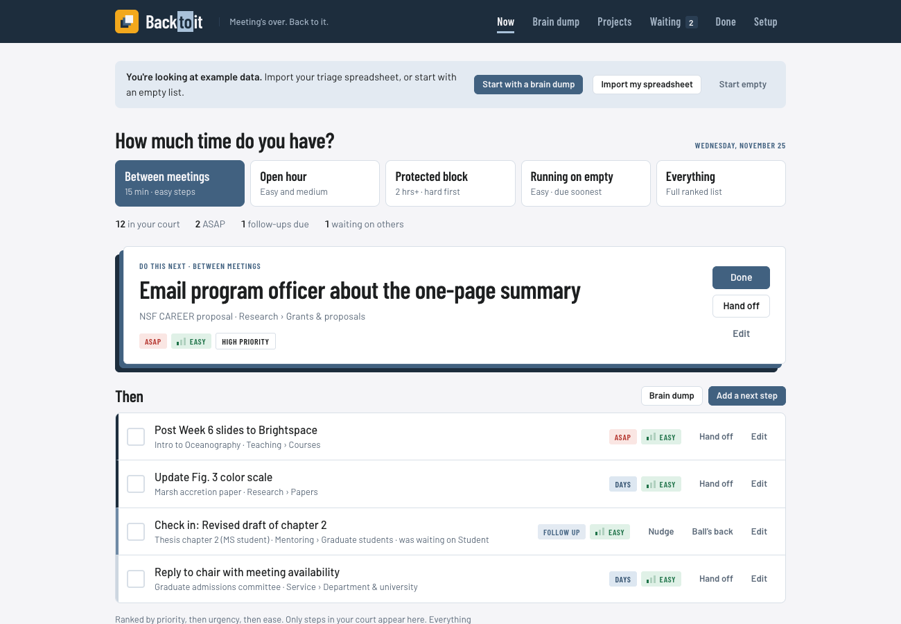

# Backtoit

**Meeting's over. Back to it.**

Backtoit is a triage app for academics. You tell it how much time you have, and it tells you
the **one thing to do next**.

Built by Kris Lewis and Erin Peck from the project-triage spreadsheets they each kept
to survive a faculty workload. Free under the MIT license.

> **Status: working prototype.** Everything runs in one file in your web browser. Accounts,
> syncing between devices and sharing with colleagues are planned (see Roadmap), not built.

---

## Who it's for

Faculty, postdocs, graduate students and research staff whose days are chopped into pieces by
meetings, especially if you:
- come out of a meeting with 20 minutes and no idea what fits in them;
- keep a to-do list so long it no longer helps you choose;
- lose track of what you handed to someone else and need to chase.

## When you'd use it

- **Between meetings (15 minutes):** tap *Between meetings*. Backtoit shows only easy steps, in
  priority order. "Email program officer about the one-page summary." Done, next.
- **A protected two-hour block:** tap *Protected block*. The hard, focused work comes first.
- **End of a long day:** tap *Running on empty*. You get easy steps with the nearest deadline
  first, so low energy still moves something forward.
- **Handing something off:** a step is now someone else's job. *Hand off* puts it on your Waiting
  shelf with a follow-up date, and it comes back to your Now screen when it's time to check in.
  It can also open a pre-filled email in your own email program; nothing is sent until you click Send.
- **Annual review season:** the *Done* log shows what you finished, week by week, with yearly
  counts per category.

## How it decides

Every next step is rated on four things:

1. **Whose court:** mine, or waiting on someone. Only *mine* appears on the Now screen.
2. **Priority** (high / medium / low), set per project. High means it moves your career forward
   *and* you want to do it.
3. **Urgency** (ASAP / days / weeks / months / no rush). An optional due date raises urgency
   automatically as the date gets closer.
4. **Ease:** *easy* means under 15 minutes and little brain power; *hard* means it needs a focused block.

Steps are sorted by priority, then urgency, then ease. The time buttons filter that list:

| Button | Shows |
|---|---|
| Between meetings | Easy steps only |
| Open hour | Easy and medium |
| Protected block | Hard steps first |
| Running on empty | Easy steps, nearest deadline first |
| Everything | The full ranked list |

Projects can hold one step or several. The first time you open it, choose Faculty, Graduate
student, Postdoc or Research staff to get starter categories (Research, Teaching, Service,
Mentoring...). Everything is editable.

## Try it (no install, no account)

1. Download this repository (green **Code** button, then **Download ZIP**) and unzip it.
2. Double-click `backtoit.html`. It opens in your web browser with example data.
3. Click **Start empty** (or **Import my spreadsheet**) when you're ready to use your own list.

**Where your data lives:** in that browser on that computer only (the browser's local storage).
Your list is never sent anywhere. If you clear your browser data, the list goes with it, so use
**Setup > Export to Excel** now and then to save a copy.

**Internet use:** the page downloads its fonts (Google Fonts) and a spreadsheet library
(SheetJS, from cdnjs) when it opens. Without internet it still works, in a plainer font, but
Excel import and export are switched off.

### Importing an existing spreadsheet
**Import my spreadsheet** reads an Excel or CSV triage list. Rows in ALL CAPS become categories,
and items marked as submitted go to the Waiting shelf. Check the result on the Projects screen.

### The brain dump (needs Claude)
The **Brain dump** screen takes a messy list, pasted spreadsheet rows, or photos of paper lists
and sticky notes, and uses Claude to sort it into projects and next steps with suggested ratings.
You keep, change or skip each suggestion, one card at a time.

It works only when `backtoit.html` is published as an artifact inside claude.ai, where the page
can ask Claude to do the sorting. In the downloaded file, the brain dump screen says so, and you
add projects by hand. If you use it in claude.ai, the text you paste goes to Anthropic's AI
service; leave out student information and anything confidential.

---

## Roadmap

| Phase | What gets built |
|---|---|
| **1. Private beta** | Sign-in with an emailed link (no password), your own private list that syncs across devices, shared projects and hand-offs between colleagues, installable on phones |
| **2. Ready for others** | Spreadsheet import during sign-up, terms and privacy policy |
| **Later** | Google Calendar "gaps in my day", Gantt/Excel import, department accounts |

## For people who want to change the code

- **Everything is in `backtoit.html`**: the page, the styles and the JavaScript, about 1,400 lines,
  with no build step and nothing to install. Open it in any text editor. The only outside pieces
  are Google Fonts and SheetJS (for Excel import and export), loaded from the web.
- Data is one JSON object saved in the browser under the key `facultyTriage.v1`.
- When the page runs inside claude.ai, it detects `window.claude` and uses the artifact's shared
  database (so two people can share a list), the downloads capability for exports, and Claude for
  the brain dump. Outside claude.ai those parts switch off on their own.
- The visual identity (Marigold `#F2A81D` on the icon tile only; Steel 900 `#1D2D3D`; Barlow and
  Barlow Condensed type) is on the brand sheet in `brand/`.

Suggestions and bug reports: open an issue on this repository.

## License

MIT. See [LICENSE](LICENSE). The Backtoit name and logo identify this project; please don't use
them for a different product.
